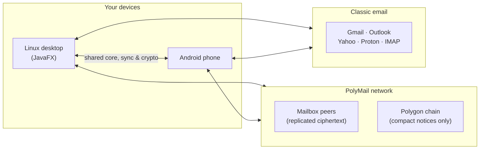
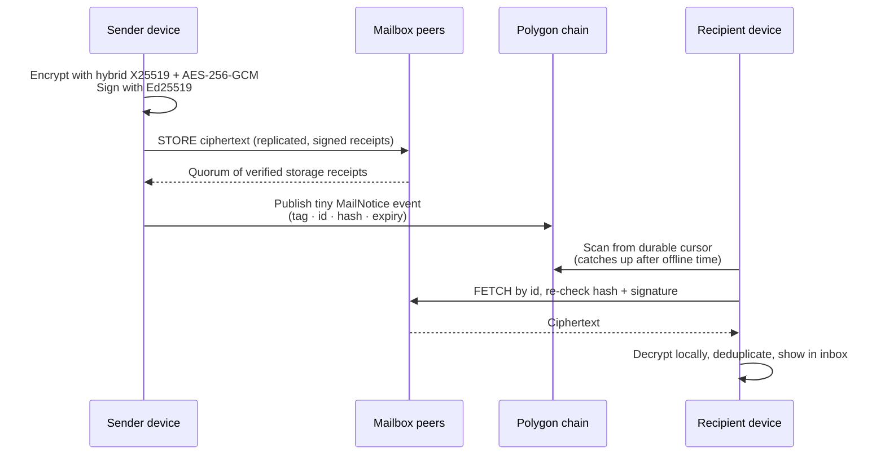
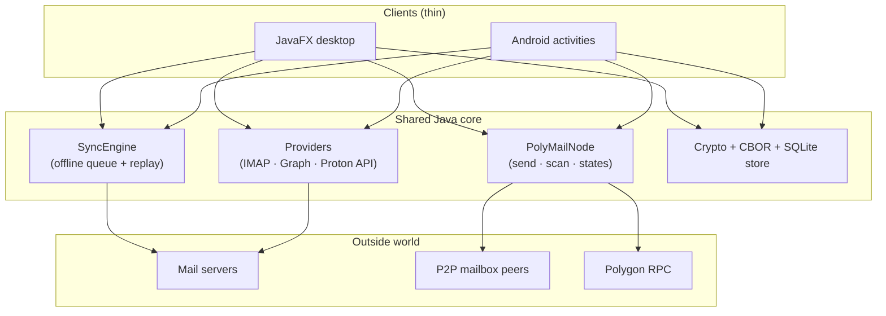

# GraalMail


**One inbox for two worlds: your everyday email accounts *and* serverless,
end-to-end encrypted PolyMail messages — on Linux desktop and Android, from a
single shared Java core.**

GraalMail is a cross-platform email client written in Java. It speaks the
email you already use (Gmail, Outlook, Yahoo, Proton Mail, any IMAP server)
and it also speaks **PolyMail**: a decentralized delivery protocol where
messages are encrypted on your device, stored across independent P2P mailbox
peers, and announced through compact events on the Polygon blockchain. No
central mail server ever sees your words.

---

## Why GraalMail?

| You want… | GraalMail gives you… |
|---|---|
| Freedom from Big Tech mail silos | Gmail, Outlook, Yahoo, Proton and plain IMAP in one unified inbox |
| Mail that no server can read or withhold | PolyMail: encrypt on your device, replicate over P2P, notify over Polygon |
| An app that works on the train, in a tunnel, offline | Offline-first: every action queues locally and replays when connected |
| Honest security, not marketing | AES-GCM credential vault, TLS everywhere, sanitized HTML, no tracking pixels |
| One codebase, two beautiful clients | JavaFX desktop + native Android sharing the same core, sync and providers |
| Software you can audit | Apache-2.0, strict module boundaries, tests against a real GreenMail server |

---

## Two ways to send, one inbox to read



### Classic email — everything you already have

- **Gmail / Google Workspace** over OAuth 2.0 + PKCE, IMAP/SMTP with XOAUTH2
- **Outlook.com / Hotmail / Microsoft 365** over OAuth 2.0, Graph API or IMAP/SMTP
- **Yahoo Mail** via app password (OAuth optional where Yahoo approves it)
- **Proton Mail** with direct username + password login (SRP), mailbox keys
  unlocked and messages PGP-decrypted **locally** — no Bridge required
- **Any IMAP/SMTP server** with auto-deduced settings from your email domain
- Unified inbox, server-side + local search, flags, attachments, drafts,
  Thunderbird-style Android UI and a Proton-style desktop with dark theme

### PolyMail — email without the mail server

Give someone your `you@graalemail` address and the servers disappear from the
picture. A PolyMail message travels like this:



What makes it trustworthy:

- **Encrypt before transmission.** Plaintext never leaves your device; peers
  and the chain only ever see ciphertext, random ids, hashes and timestamps.
- **Separate keys for separate jobs.** Wallet, signing and encryption keys are
  independent. Losing one does not silently compromise the others, and revoked
  keys fail closed on both send and receive paths.
- **Independent lifecycles.** The chain notice and the P2P content reconcile
  like a saga: storage failure never fakes a delivery, notification failure is
  retried, and a recipient that was offline for a month still catches up from
  the durable scan cursor.
- **No false "Delivered".** The UI walks every message through
  *Queued → Uploading → Stored → Notification submitted → Confirmed → Waiting
  for retrieval → Delivered / Acknowledged*, and never shows *Delivered*
  before acknowledgement.
- **Spam resistance without tokenomics.** Rate limits, sender allowlists and
  an opt-in deposit policy (off by default) — economics only after the basic
  lifecycle proves reliable.
- **Four isolated networks.** `dev`, `int`, `test` and `prod` namespaces never
  interoperate; the handshake rejects a mismatched network before any protocol
  traffic flows.

The cryptography is boring on purpose: X25519, HKDF, AES-256-GCM, Ed25519,
SHA-256, deterministic CBOR — established primitives, pinned by
cross-platform golden-vector tests so desktop and Android produce
byte-identical envelopes.

---

## Under the hood



- **Strict module boundaries.** `core` and `provider-api` know nothing about
  providers, databases or UIs. Providers plug in via service loader and can be
  removed without touching surrounding code.
- **Offline-first by construction.** Every action lands in a durable queue and
  stays *pending* until the server confirms it. The UI shows pending, never
  completed-before-its-time.
- **Background done right.** Desktop runs PolyMail on a managed executor with
  startup / wallet-unlock / shutdown hooks; Android reconciles through
  WorkManager with battery-aware scheduling and survives process death via the
  durable cursor.
- **Tested like infrastructure.** Unit, protocol, scanner, durability, fuzz and
  transport suites; IMAP/SMTP paths exercised against a real GreenMail server;
  golden vectors lock the cross-platform wire format.

---

## Security at a glance

| Threat | How GraalMail answers |
|---|---|
| Stolen credentials | AES-256-GCM vault (PBKDF2 master key on desktop, Android Keystore on mobile) |
| Network snoopers | Full TLS with hostname verification; plain connections on TLS ports rejected |
| Malicious email | jsoup sanitization, scripts stripped, remote images blocked by default |
| Malicious attachments | Never executed or auto-opened, filenames sanitized, 25 MB cap |
| Leaky logs | Automatic redaction of passwords, tokens and bearer headers |
| SQL injection | Prepared statements with bound parameters everywhere |
| Lost devices / keys | Passphrase-sealed `PMBK1` backups, signed multi-device enrollment |

Read the full threat model in [SECURITY.md](SECURITY.md) before trusting it
with real mail — and note the honest limits at the bottom of this file.

---

## Provider status

| Provider | Sign-in | Read | Send | Notes |
|---|---|---|---|---|
| Gmail / Workspace | OAuth 2.0 + PKCE | IMAP | SMTP | Labels as folders |
| Outlook / Microsoft 365 | OAuth 2.0 + PKCE | Graph or IMAP | Yes | Graph default, IMAP selectable |
| Yahoo | App password (OAuth optional) | IMAP | SMTP | Needs Yahoo-generated app password |
| Proton (desktop + Android) | Username + password (SRP) | Proton API, local PGP decrypt | Not yet | 2FA + two-password mode supported |
| Any IMAP provider | Password / app password | IMAP | SMTP | Settings deduced from domain |

Live accounts of the hosted providers were not available in the build
environment, so those paths are *implemented and unit-tested, unverified
against the live service*. Details in
[PROVIDER_SUPPORT.md](PROVIDER_SUPPORT.md).

---

## Get started

**Requirements:** JDK 25 · Android SDK (platform 35) only for the mobile build.

```bash
# run the desktop app
./gradlew :desktop:run

# run all tests
./gradlew test

# build the debug APK -> android/build/outputs/apk/debug/android-debug.apk
./gradlew :android:assembleDebug

# self-contained Linux image + tarball -> desktop/build/dist
./gradlew :desktop:packageAppImageTarball
```

Add `--offline` once dependencies are cached.

**Add an account:** `File ▸ Add account`, type your email — the provider is
detected from the domain. OAuth providers open a browser flow; Proton asks for
username + password (+ mailbox password and 2FA code when needed).

**Try PolyMail:** open `Tools ▸ Settings ▸ PolyMail`, enable it, set your
`you@graalemail` identity, two Polygon RPC endpoints and the notification
contract address (plus reachable `host:port` mailbox peers to actually
deliver). Send to another `@graalemail` address and watch the delivery states
walk the whole path. Same screen exists in Android settings.

Your data lives in `~/.local/share/GraalMail` (`graalmail.db`,
`credentials.bin`, key material). Set `GRAALMAIL_PASSPHRASE` from your own
secret management for any serious deployment.

---

## Operating PolyMail

> This section condenses the operator guide (`docs/P2P_DEPLOYMENT.md`,
> kept out of git by design) so deployers get everything from this file
> alone. The full engineering spec lives in `docs/P2P_POLYMAIL.md`.

### Networks — they never mix

| Namespace | Chain | Purpose |
|---|---|---|
| `dev` | local dev chain | deterministic contract + protocol tests |
| `int` | Polygon Amoy | integration tests |
| `test` | Polygon Amoy, test contracts | public test network |
| `prod` | Polygon PoS mainnet | production |

Configure exactly one namespace per node. The handshake rejects mismatched
network ids before any protocol traffic flows — test traffic can never touch
production contracts or peers.

### Smart contracts

Sources: `contracts/PolyMailIdentity.sol` (username registry + key records),
`contracts/PolyMailNotifications.sol` (notification events + opt-in deposit
policy).

Deploy order:

1. Deploy `PolyMailIdentity`.
2. Deploy `PolyMailNotifications` with **no deposit policy** (deposits
   disabled: `depositRecipient == address(0)`).
3. Pin the contract addresses + chain id in every client configuration.
4. Enable a deposit policy via `setDepositPolicy` (owner-only) only after the
   basic lifecycle proves reliable — and announce changes out-of-band.

The notification event (final ABI, all networks):

```solidity
event MailNotice(
    bytes32 indexed inboxTag,
    bytes32 indexed messageId,
    bytes32 contentHash,
    uint64 expiresAt,
    bytes32 networkHint
);
```

`expiresAt` is an absolute Unix timestamp and is advisory — the contract does
not enforce it; clients enforce expiry locally. Only tags, random message
ids, hashes and timestamps ever go on chain: **no plaintext, keys or
addresses, ever.**

### Client configuration

`PolyMailConfig` carries: RPC URLs (**plural — configure at least two
independent endpoints for failover**), contract address, chain id, network
id, listen port, confirmation depth (minimum 2 on Amoy, higher on mainnet),
required replicas.

Rules that are enforced, not suggested:

- Contract address and chain id are validated on every scan; mismatched
  events are dropped.
- A message is marked *notified* only at confirmation depth — never from a
  transaction hash alone.
- Use WebSocket subscriptions for timeliness where supported, but never rely
  on them alone: every reconnect replays historical logs from the durable
  cursor.

### Running peers

Three logical roles (one process may serve several):

- **Client peer** — `PolyMailNode` via `DesktopPolyMailService` (desktop) or
  `PolyMailWorker`/`PolyMailScheduler` (Android). Desktop listens on the
  configured TCP port; Android is dial-out only and relies on reachable
  mailbox nodes.
- **Mailbox peer** — a reachable host running the TCP transport with storage.
  Operate at least `requiredReplicas + 1` independent mailbox peers so mail
  survives a single loss; the replication manager repairs back to quorum.
- **Bootstrap peer** — long-lived reachable node for peer discovery. Run
  several, independently operated. Bootstrap peers are discovery only: never
  identity authorities, never able to decrypt mail.

**NAT:** direct dial first with bounded timeouts. Peers behind NAT either
port-forward the listen port or use a recipient-operated reachable mailbox
node as relay. Undeliverable peers report `PEER_UNREACHABLE` and the sender
keeps the message queued — delivery is never claimed on a failed dial.

### Key management

- Wallet (chain auth), signing and encryption keys are **separate**. The
  wallet never decrypts mail.
- Desktop: passphrase-protected AES-GCM store (set `GRAALMAIL_PASSPHRASE`
  from real secret management for any serious deployment). Android:
  hardware-backed key-encryption key where the device supports it.
- Back up with the passphrase-sealed `PMBK1` blobs and **test restores** —
  lost private keys mean lost messages.
- Device changes go through signed enrollment; never publish replacement keys
  without proving wallet ownership. Revoked/expired keys fail closed on send
  *and* receive.

### Monitoring

Log send state transitions, scan reports (scanned / matched / delivered /
skipped / failed), receipt verification failures and reorg rewinds — never
private keys, plaintext or full envelopes. Alert on: quorum failures trending
up, `PEER_UNREACHABLE` on mailbox peers, cursor stalling (head advancing,
cursor not), rate-limit rejections (spam wave or misconfiguration).

### Pre-release checklist

- [ ] Contracts deployed + addresses pinned per network; deposit policy off
- [ ] Independent RPC endpoints configured and failover tested
- [ ] `requiredReplicas + 1` mailbox peers, independently operated
- [ ] Bootstrap nodes documented and reachable
- [ ] Independent review of the cryptographic protocol and contracts
- [ ] Fuzz + protocol + integration suites green; vectors cross-checked
      between desktop and Android builds

### Privacy notes

Assume all Polygon event data is public: timing, submitter, frequency and
sender↔activity correlations are observable even with encrypted bodies. The
protocol uses one-time recipient notification tags and keeps subjects, bodies
and attachment names encrypted — but that is confidentiality, not anonymity.
Do not claim anonymity merely because the body is encrypted.

---

## Project map

| Area | Where | Start with |
|---|---|---|
| Module design, data flow | [ARCHITECTURE.md](ARCHITECTURE.md) | Message flow diagram |
| Threat model, crypto rules | [SECURITY.md](SECURITY.md) | Credential storage |
| Provider matrix + setup | [PROVIDER_SUPPORT.md](PROVIDER_SUPPORT.md) | Your provider's section |
| Operating peers + contracts | This file, [Operating PolyMail](#operating-polymail) | Networks table |
| Protocol spec + lifecycle | This file, [PolyMail](#polymail--email-without-the-mail-server) | Send/receive diagram |
| Testing guide | [TESTING.md](TESTING.md) | Module test commands |
| Contributing | [CONTRIBUTING.md](CONTRIBUTING.md) | Coding rules |

> Note: the `docs/` folder (full engineering spec, deployment guide,
> implementation status, UI refactor plans) is intentionally not committed —
> everything a user or operator needs is summarized in this README.

---

## Roadmap

Done: shared protocol core, NIO transport with handshake, durable
delivery + resume, Polygon scanner with reorg recovery, replication repair,
key backup/enrollment, desktop + Android UI bindings, settings on both
platforms, file-backed peer discovery, golden vectors, schema migrations.

Next: full Kademlia DHT discovery, libp2p transport re-evaluation, and the
independent cryptographic + contract review required before mainnet (spec 18).

---

## Known limitations (read before takeoff)

- No UI run was ever exercised against a live mailbox here; provider paths
  are protocol-tested, not live-verified.
- Proton sending and server drafts are not supported yet.
- A message *accepted* by a server is reported as accepted — never as
  delivered.
- The desktop vault is a passphrase-protected file, not an OS keyring; the
  mail cache at rest is not encrypted.

---

## License

Apache License 2.0 — see [LICENSE](LICENSE). Contributions welcome via
[CONTRIBUTING.md](CONTRIBUTING.md).
